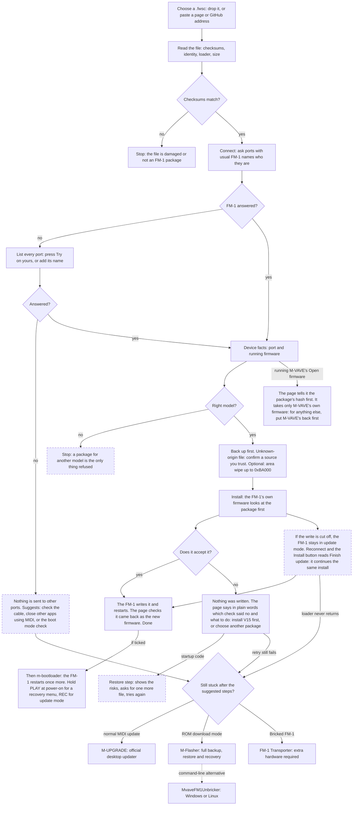
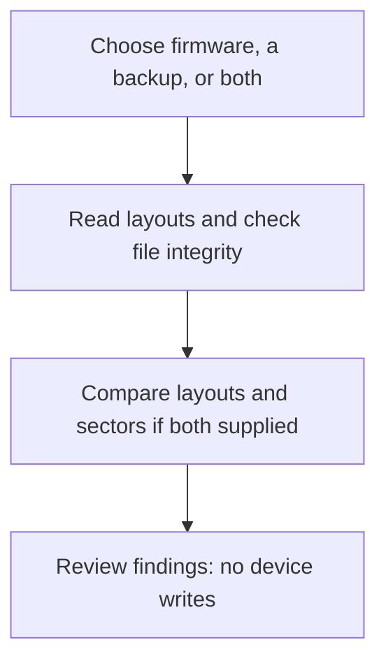

# fm-static

**[Open fm-static](https://seajaysec.github.io/fm-static/)**

A web page that installs a `.fwsc` firmware file on an M-VAVE FM-1 over USB, for one situation:
**your FM-1's MIDI port has a different name on your computer, and the usual updaters can't find it.**

That can happen on purpose (you renamed the device) or by itself. On a Mac, Audio MIDI Setup names a
USB MIDI port from its own cache, keyed by the USB id and the socket. Many FM-1 firmwares share the
same USB id and send no serial number, so an FM-1 can show the name of another device or firmware
that was last plugged into that socket. Updaters that look for the FM-1 by name then report it as
not found, or lose it halfway through an update.

If your firmware's own updater, or M-VAVE's, works for you, use that instead.

## What it does

**Flash** is the default tab and keeps the installation workflow. **Layout Analysis** provides file analysis only: it can
inspect the Flash selection, a separately chosen `.fwsc`, a raw backup, or both files together. A package chosen in
Layout Analysis never changes the install selection. **Use the Flash selection** returns the analysis to that package and its
selected write options. Switching tabs preserves both selections. During installation the tabs stay on Flash so progress
remains visible. Inspection warnings about the install file also appear on Flash. **Backup & Recovery** collects external
backup and recovery tools. **About** contains the feature comparison and links to the troubleshooting workflow, which is visible on **Flash**. Internal recovery
links select the recovery tab without changing either file selection.

Backup creation and backup restore are not implemented. The existing **Restore official startup code** operation is
a firmware-install workaround, not restoration of a raw flash backup.

For a full-flash backup or ROM download-mode recovery, the recommended desktop route is
[M-Flasher](https://github.com/jvitkauskas/m-flasher) (Windows, macOS, Linux). Open the raw `.bin` it saves in Layout Analysis.
[M-UPGRADE](https://www.m-vave.com/download) is M-VAVE's official desktop firmware updater; raw backup support has not been
verified. [MvaveFM1Unbricker](https://github.com/Quixotic7/MvaveFM1Unbricker) is a Windows/Linux command-line recovery alternative
when the FM-1 appears as WL82 UBOOT1.00. [FM-1 Transporter](https://github.com/kurogedelic/FM-1-transporter) provides a hardware
route with an extra RP2040/RP2350 board and its own serial web app. Those external device operations are not performed by this page.

- Reads any `.fwsc` in the browser (nothing is uploaded), checks its CRCs and shows its identity and
  SHA-256. Only the unmodified official V15 is recognised by hash; anything else is labelled, and a
  file of unknown origin needs a confirmation before it can be installed.
- Takes a saved web page too: if it carries firmware packages inside it as text (M-VAVE's Workbench holds the Open firmware
  and the original V15 that way), they are pulled out and checked like any file.
- Can find the file for you: paste the address of a page, or of a GitHub repository, that offers firmware, and the browser reads it itself,
  lists the `.fwsc` files in its source (or loads the one it finds). It works only for sites that allow other pages to
  read them; for the rest it says so and you download the file and drop it in.
- **Package layout and write preview**: decodes the boot and application tables, checks internal application-file CRCs,
  and shows the regions declared for settings, Bluetooth pairings, sequences and other data. The preview uses the
  recognised loader design to show expected firmware writes; unknown loaders get no guessed write range. It does not
  read the live flash. Staging and update-record cleanup may write outside those ranges, and custom firmware may use
  data differently from its declarations.
- **Offline backup inspection**: open a raw 1 MiB `.bin` flash backup, even without connecting an FM-1. With a package
  selected, compare declared data layouts and count differing bytes within the expected firmware write ranges. This
  compares files, not the connected device; it neither creates nor restores backups and does not prove data compatibility.
  The comparison also counts complete matching/differing 4 KiB sectors and sectors that are all `0xFF` in the backup.
  Erased bytes alone do not diagnose an interrupted update.
- Optional **application/data wipe**: writes the chosen firmware with M-VAVE's update loader over a package covering flash up to 0xBA000,
  so every sector in that range is erased first (saved projects and settings kept there are lost). The package is built
  from the official V15 package's loader and startup code plus the chosen firmware's app area, the way a Baudgirl
  release is V15 with another flash.bin; the builder reproduces all ten Baudgirl packages inspected byte for byte.
  This is not a complete settings or Bluetooth reset: V16's settings start at 0xBA000, and stock V15/V16 Bluetooth
  pairings lie beyond the wipe range. The wipe operation itself is unchanged.
- Can read a GitHub repository address: it lists the `.fwsc` files committed in the repo (loadable) and attached to
  releases (download-only: GitHub does not let a web page read those). For files GitHub holds a build attestation for, it
  shows which workflow built them from which commit; it reports what GitHub says and does not verify the signature.
- Lists every MIDI port. Ports with a usual FM-1 name are asked who they are; any other port is sent
  nothing until you press **Try this port** on it.
- Lets you keep your own port names, so the page finds your FM-1 by itself next time (stored in
  your browser only).
- During an install, follows the FM-1 as its port changes when it restarts into the update loader
  and back.
- If an update was cut off and the FM-1 is still in update mode, offers **Finish update**.
- Installs over any firmware: it never refuses because of what the FM-1 runs now (only a wrong model). It reads the
  package (which update loader it carries, flash.bin size, whether its startup code is official V15's) and lists what it
  saw as checkpoints, including what an installer that only starts from V15 would have stopped on.
- If a Felucca-family firmware refuses a package, it says which check refused (app area size, loader, or startup code).
  For the startup-code refusal there is an opt-in **Restore official startup code** mode: it answers that check with the
  startup code of a Felucca-family file you pick, then M-VAVE's loader writes the package. It rewrites the region a
  failed write can leave unbootable, and has not been run on a device; the page lists the risks and why.

Needs Chrome or Edge on a computer (Web MIDI with SysEx). Installing firmware is at your own risk.

To fix the name itself on a Mac: Audio MIDI Setup, Window, Show MIDI Studio, double-click the device.

## Where the update protocol comes from

The update protocol and the package reader are [fm1-base](https://github.com/charlesvestal/fm1-base)'s, copied unmodified into
`vendor/fm1-base/` (recorded in `vendor/fm1-base/SOURCE`). `src/updater.js` adds what the page does on top: finding the FM-1 under any
port name, following the ports through the update loader, the restore step, and what step 1 refused. To take fm1-base's latest:
`tools/sync-base.sh`. A weekly GitHub job does the same and opens a pull request when anything changed, so fixes arrive for review
and nothing reaches the page without a merge. `node tools/check-vendor.mjs` checks the copies still offer what the adapter uses.

## How it gets past a snag

Where the page checks something, what it does when the check fails, and what you are offered. Boxes with a dashed outline
are paths that have not been run on an FM-1 yet.



The About tab uses a responsive feature table comparing M-VAVE Open Workbench, community installers, FM-Static,
and named external recovery tools. Community support for arbitrary packages and V15-first gating is described as variable;
Felucca is a reference example, not the whole category. FM-Static imposes no V15-first gate and checks the device and package.
The comparison explicitly covers install assistance: manually chosen ports, tracking port changes, known refusal checkpoints,
the opt-in startup-code workaround, Open firmware handshaking, area wipe and expected write regions. It distinguishes those
from shared restart verification and interrupted-update retries, and labels the untested restore path.
Firmware-specific project backups are grouped with the tasks delegated to other tools. Sources and the review date are
shown with the table. Every cell uses the same status key: supported, limited/variable/different approach, or not provided/out
of scope. Supported external-tool entries name the tool, with distinct check colours for M-Flasher, Unbricker and Transporter.
On phones, each feature lists all four tools.

The page uses responsive HTML/CSS workflows: horizontal on wide screens, vertical on smaller screens, with readable text and no diagram scrolling. Mermaid is used only in this README.

### Layout Analysis



## What has and has not been tested

Run on a real FM-1 (macOS, Chrome): installs in every direction between official V15, M-VAVE's V16, Baudgirl releases,
Felucca-family firmwares and Mutable Dreams, with and without the application/data wipe; a real refusal by a newer Felucca and the way
round it; installing m-bootloader after a firmware and then putting M-VAVE's V16 back over it; a package found through a
GitHub address; an FM-1 whose port name the page does not recognise (found with Try this port, then followed through the
update loader); another app holding the MIDI ports during an install; M-VAVE's Open firmware (V14, installed with M-VAVE's own Workbench) and from it back to M-VAVE's V16 through this page.

Not tested on a device: finishing an interrupted update, the startup-code refusal and its restore step, boot-mode
detection, the wrong-model refusal, m-bootloader's recovery menu and update-mode keys. Out of scope:
how the firmware sounds, the SMK-37 (it may work; completely untested), browsers other than Chrome.

The read-only inspection additions have host coverage for V15/V16 layouts, malformed tables, internal CRCs, unknown
loaders, wipe boundaries and file comparisons. Real V15, V16 and SLOOP packages were also checked. These are file/parser
checks, not new device-flashing tests. To run them (Node 22 or newer):

```
node tools/test-flash.mjs
node tools/test-flash.mjs /path/to/firmware.fwsc   # optional real-package checks
node tools/check-vendor.mjs
```

To check the UI: load V16, switch to **Layout Analysis**, expand **Package layout and affected regions**, and inspect VM, SEQ64 and BTIF. Open
**Inspect a flash backup**, choose a V15 raw backup, and check the layout differences. Removing the backup must leave
the selected firmware in place. A project export or wrong-sized file must report an error without changing the package.
Loading a backup alone never requests MIDI access.

For the automated Chrome check, serve this folder at `http://127.0.0.1:8873`, install `playwright-core` in your test
environment, and run `node tools/test-browser.mjs /path/to/V15.fwsc /path/to/V16.fwsc`. `PLAYWRIGHT_MODULE` can point
to an existing Playwright module; `FLASH_TEST_URL` overrides the server address. The test supplies a simulated MIDI
identity and never accesses hardware. It checks backup-only use, layout differences, wipe previews, invalid files,
clearing, package changes, all four tabs and their keyboard navigation, the install navigation lock, recovery links,
and layouts at 320, 390, 780, 1024 and 1440 pixels. To check manually, switch through all four tabs, use a recovery link
from About or Layout Analysis, and narrow the window: the table and workflows should reflow without sideways scrolling.

## Lineage and licence

The update protocol comes from [Felucca](https://github.com/hugelton/Felucca)'s web installer
by Leo Kuroshita (Hügelton Instruments), in the MPL-2.0 copy published by
[fm1-base](https://github.com/charlesvestal/fm1-base). The page is MIT. Package checking,
rebuilding and the application/data wipe are this page's own code. Flash-table decoding adapts MIT-licensed code credited
in [NOTICE](NOTICE); its licence is retained alongside the existing MPL notices. See [LICENSE](LICENSE).

## Running it locally

It is plain static files with no build step. Web MIDI needs `https://` or `localhost`:

```
python3 -m http.server 8000     # then open http://localhost:8000/
```
