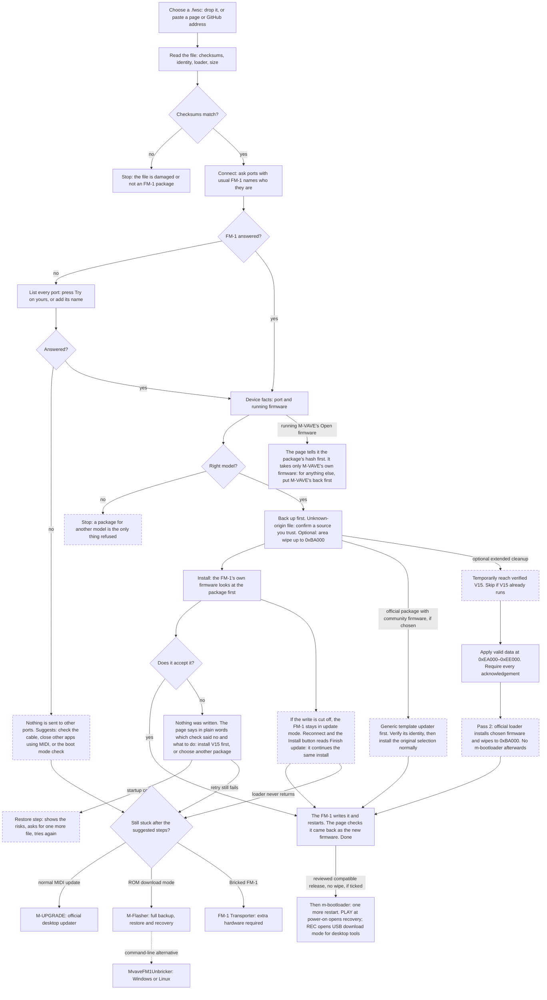
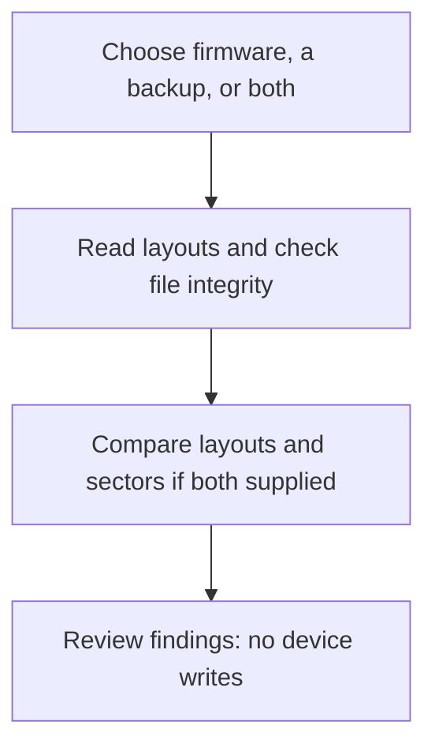

# fm-static

**[Open fm-static](https://seajaysec.github.io/fm-static/)**

A web page that installs a `.fwsc` firmware file on an M-VAVE FM-1 over USB, for one situation:
**your FM-1's MIDI port has a different name on your computer, and the usual updaters can't find it.**

That can happen on purpose (you renamed the device) or by itself. On a Mac, Audio MIDI Setup names a
USB MIDI port from its own cache, keyed by the USB id and the socket. Many FM-1 firmwares share the
same USB id and send no serial number, so an FM-1 can show the name of another device or firmware
that was last plugged into that socket. Updaters that look for the FM-1 by name then report it as
not found, or lose it halfway through an update.

If your firmware's own updater, or M-VAVE's, works for you, use that instead.

## What it does

**Firmware file** is shared above the tabs, on the upper right on wide screens. Choose a local package, saved updater page,
or URL once: **Flash** and **Layout Analysis** use that same package. Selecting firmware does not connect to the device.
Changing it updates both views and resets install options and confirmations; an invalid replacement leaves the previous
selection intact. Package details are expandable, while selection errors and internal checksum warnings stay visible.

**Flash** is the default tab and owns device connection and installation. **Layout Analysis** inspects the shared firmware,
a raw backup, or both. Switching tabs preserves the firmware, backup and chosen install options. During installation,
navigation and the shared picker are locked so progress stays visible and the package cannot change.
**Backup & Recovery** collects external backup and recovery tools. **About** contains the feature comparison and links to
the troubleshooting workflow on **Flash**. Internal links switch tabs without replacing the selected files.

Backup creation and backup restore are not implemented. The existing **Restore official startup code** operation is
a firmware-install workaround, not restoration of a raw flash backup.

For a full-flash backup or ROM download-mode recovery, the recommended desktop route is
[M-Flasher](https://github.com/jvitkauskas/m-flasher) (Windows, macOS, Linux). Open the raw `.bin` it saves in Layout Analysis.
[M-UPGRADE](https://www.m-vave.com/download) is M-VAVE's official desktop firmware updater; raw backup support has not been
verified. [MvaveFM1Unbricker](https://github.com/Quixotic7/MvaveFM1Unbricker) is a Windows/Linux command-line recovery alternative
when the FM-1 appears as WL82 UBOOT1.00. [FM-1 Transporter](https://github.com/kurogedelic/FM-1-transporter) provides a hardware
route with an extra RP2040/RP2350 board and its own serial web app. Those external device operations are not performed by this page.

- Reads any `.fwsc` in the browser (nothing is uploaded), checks its CRCs and shows its identity and
  SHA-256. Only the unmodified official V15 is recognised by hash; anything else is labelled, and a
  file of unknown origin needs a confirmation before it can be installed.
- Takes a saved web page too: if it carries firmware packages inside it as text (M-VAVE's Workbench holds the Open firmware
  and the original V15 that way), they are pulled out and checked like any file.
- Can find the file for you: paste the address of a page, or of a GitHub repository, that offers firmware, and the browser reads it itself,
  lists the `.fwsc` files in its source (or loads the one it finds). It works only for sites that allow other pages to
  read them; for the rest it says so and you download the file and drop it in.
- **Package layout and write preview**: decodes the boot and application tables, checks internal application-file CRCs,
  and shows the regions declared for settings, Bluetooth pairings, sequences and other data. The preview uses the
  recognised loader design to show expected firmware writes; unknown loaders get no guessed write range. It does not
  read the live flash. Staging and update-record cleanup may write outside those ranges, and custom firmware may use
  data differently from its declarations.
- **Offline backup inspection**: open a raw 1 MiB `.bin` flash backup, even without connecting an FM-1. With a package
  selected, compare declared data layouts and count differing bytes within the expected firmware write ranges. This
  compares files, not the connected device; it neither creates nor restores backups and does not prove data compatibility.
  The comparison also counts complete matching/differing 4 KiB sectors and sectors that are all `0xFF` in the backup.
  Erased bytes alone do not diagnose an interrupted update.
- Optional **application/data wipe**, usually unnecessary: try a normal install first. It may be worth trying if a normal
  flash fails. Writes the chosen firmware with M-VAVE's update loader over a package covering flash up to 0xBA000,
  so every sector in that range is erased first (saved projects and settings kept there are lost). The package is built
  from the official V15 package's loader and startup code plus the chosen firmware's app area, the way a Baudgirl
  release is V15 with another flash.bin; the builder reproduces all ten Baudgirl packages inspected byte for byte.
  Cleanup first reaches verified official V15 as a temporary maintenance step, then applies fixed valid data to
  the 16 KiB voice region at 0xEA000–0xEE000, beyond the firmware wipe's reach, before installing the chosen firmware.
  This replaces all 128 stored voices. In V16 that extra region overlaps sequence data and Bluetooth pairings;
  its settings region at 0xBA000–0xDA000 remains outside the planned writes. This is not a whole-flash reset.
  The four data files are pinned by SHA-256 and checked before any installation starts. Each erase and write must
  be acknowledged; this is not a readback check. A failed data step stops the final install, and retry rewrites all four banks.
  Only the verified V15 file is accepted as the template; it never replaces the user's final firmware selection.
  Standard application-loader packages use their own writer for the first V15 pass, preserving startup code;
  other packages use V15's official writer, which the running firmware may refuse. If V15 already answers, its install is skipped.
  The V15 pitstop was device tested from Optimist 0.2 synths with m-bootloader 1.2 retained and 386DX FM-1_3860070 selected. Other target writers and custom startup code remain unverified; failure can require external recovery.
  Keep the page open: retry/resume retains the exact current step in memory, but reloading loses it.
  Cancelling remaining passes does not undo completed writes. Normal installs and the generic temporary-updater route do not add this cleanup.
- Optional **m-bootloader installation** requires support in the selected firmware's updater, which runs after the
  firmware install. An application-only update loader does not establish that support. The option appears only for
  reviewed package hashes and is always omitted with a wipe. Unknown builds remain hidden rather than guessed compatible.
  Official V15 is supported according to [m-bootloader's device-tested M-UPGRADE installation](https://github.com/jvitkauskas/m-bootloader#with-m-vaves-updater);
  this page's V15 pairing has not been device tested. The reviewed community entry is [LOOM 0.9](https://github.com/charlesvestal/fm1-loom/releases/tag/v0.9), SHA-256
  `d134cb28486ba35279e622a024db74ac8afa0e017d09f3d0c9507c25b6470a75`. Its pinned
  [updater](https://github.com/hugelton/felucca-bsp/blob/305c372c3ec18f3917744e608998a0d7fd700135/chip/ota.c)
  accepts packages without `flash.bin`; host simulation accepts the bundled installer. This exact pairing completed on
  an FM-1 through this page, returning `FM-1_10000900` after the bootloader installer.
  Releases requiring both `flash.bin` and `ota.bin` reject the standalone installer at the header check.
- **Install through a temporary updater**: when selecting an official-loader FM-1 package while community firmware
  answers, an optional two-pass route installs the generic fm1-base template 0.3 first, verifies its identity, then
  installs the original selection. It does not add the extended wipe or m-bootloader. Normal installation remains the
  default. The warning is based on firmware identity; this page cannot determine the installed bootloader from that reply.
  This helps with older updaters that compare the incoming startup code byte for byte with the device's current code.
  A file identifying itself as V15 (`FM-1_015`) is eligible only when its SHA-256 matches the verified official V15;
  a matching name or valid package CRC alone is not enough. The V15 wipe template uses the same exact-file check.
  The [upstream template file](https://github.com/charlesvestal/fm1-base/blob/cb2baf68226d3eca38b3c1909423e029f0474626/firmware/template-0.3.fwsc)
  is fetched at that immutable revision and must match SHA-256
  `a62e6d803b0fa223839d4af1eb558a4d02cc27b1f5c492e93b4a49beedc00538` and identity `FM-1_11000300`.
  Upstream identifies its source as [934e40d](https://github.com/charlesvestal/fm1-base/tree/934e40d846d84e76e9c428d37b74bccb6192c823),
  with BSP [2cd696a](https://github.com/hugelton/felucca-bsp/tree/2cd696a2b94341077303e9132bb4be3d0a87ebcf).
  That updater accepts official V15 and the standalone boot installer in host simulation; the exact template is also
  in the boot-option allowlist. The complete return-to-V15 route was tested on an FM-1 from Optimist 0.2 synths with
  m-bootloader, after reproducing the four-request refusal. Other starting builds remain unverified, as does installing
  m-bootloader through the template. Temporary firmware may change saved data; back up first. Official updates replace m-bootloader.
  Both two-pass routes retain their current package for retry, require only one responding FM-1, and pin the next pass
  to the port that returned the verified identity. After failure, fresh discovery and explicit device selection are required.
- Can read a GitHub repository address: it lists the `.fwsc` files committed in the repo (loadable) and attached to
  releases (download-only: GitHub does not let a web page read those). For files GitHub holds a build attestation for, it
  shows which workflow built them from which commit; it reports what GitHub says and does not verify the signature.
- Lists every MIDI port. Ports with a usual FM-1 name are asked who they are; any other port is sent
  nothing until you press **Try this port** on it.
- Lets you keep your own port names, so the page finds your FM-1 by itself next time (stored in
  your browser only).
- During an install, follows the FM-1 as its port changes when it restarts into the update loader
  and back. After success, refreshes the device list after 1.5 seconds and retries up to three more times if the expected
  identity is missing. Loading another file or starting another install cancels the pending checks.
- If an update was cut off and the FM-1 is still in update mode, offers **Finish update**.
- Backup & Recovery explains firmware-specific rescue controls, ROM download mode and the desktop backup/install/restart
  sequence. These instructions remain available without WebUSB; the optional USB picker only identifies devices.
- Installs over any firmware: it never refuses because of what the FM-1 runs now (only a wrong model). It reads the
  package (which update loader it carries, flash.bin size, whether its startup code is official V15's) and lists what it
  saw as checkpoints, including what an installer that only starts from V15 would have stopped on.
- If a Felucca-family firmware refuses a package, it says which check refused (app area size, loader, or startup code).
  For the startup-code refusal there is an opt-in **Restore official startup code** mode: it answers that check with the
  startup code of a Felucca-family file you pick, then M-VAVE's loader writes the package. It rewrites the region a
  failed write can leave unbootable, and has not been run on a device; the page lists the risks and why.

Needs Chrome or Edge on a computer (Web MIDI with SysEx). Installing firmware is at your own risk.

To fix the name itself on a Mac: Audio MIDI Setup, Window, Show MIDI Studio, double-click the device.

## Where the update protocol comes from

The update protocol and the package reader are [fm1-base](https://github.com/charlesvestal/fm1-base)'s, copied unmodified into
`vendor/fm1-base/` (recorded in `vendor/fm1-base/SOURCE`). `src/updater.js` adds what the page does on top: finding the FM-1 under any
port name, following the ports through the update loader, the restore step, and what step 1 refused. To take fm1-base's latest:
`tools/sync-base.sh`. A weekly GitHub job does the same and opens a pull request when anything changed, so fixes arrive for review
and nothing reaches the page without a merge. `node tools/check-vendor.mjs` checks the copies still offer what the adapter uses.

## How it gets past a snag

Where the page checks something, what it does when the check fails, and what you are offered. Boxes with a dashed outline
are paths that have not been run on an FM-1 yet.



The About tab uses a responsive feature table comparing M-VAVE Open Workbench, community installers, FM-Static,
and named external recovery tools. Community support for arbitrary packages and V15-first gating is described as variable;
Felucca is a reference example, not the whole category. FM-Static imposes no V15-first gate and checks the device and package.
The comparison explicitly covers install assistance: manually chosen ports, tracking port changes, known refusal checkpoints,
the opt-in startup-code workaround, Open firmware handshaking, area wipe and expected write regions. It distinguishes those
from shared restart verification and interrupted-update retries, and labels the untested restore path.
Firmware-specific project backups are grouped with the tasks delegated to other tools. Sources and the review date are
shown with the table. Every cell uses the same status key: supported, limited/variable/different approach, or not provided/out
of scope. Supported external-tool entries name the tool, with distinct check colours for M-Flasher, Unbricker and Transporter.
On phones, each feature lists all four tools.

The page uses responsive HTML/CSS workflows: horizontal on wide screens, vertical on smaller screens, with readable text and no diagram scrolling. Mermaid is used only in this README.

### Layout Analysis



## What has and has not been tested

Run on a real FM-1 (macOS, Chrome): installs in every direction between official V15, M-VAVE's V16, Baudgirl releases,
Felucca-family firmwares and Mutable Dreams, with and without the application/data wipe; a real refusal by a newer Felucca and the way
round it; installing m-bootloader after a firmware and then putting M-VAVE's V16 back over it; a package found through a
GitHub address; an FM-1 whose port name the page does not recognise (found with Try this port, then followed through the
update loader); another app holding the MIDI ports during an install; M-VAVE's Open firmware (V14, installed with M-VAVE's own Workbench) and from it back to M-VAVE's V16 through this page.

On 2026-10-26, another real-device test installed the reviewed LOOM 0.9 package and bundled m-bootloader 1.2, then
[Optimist 0.2 synths](https://github.com/w0ts/optimist/releases/tag/v0.2), identity `FM-1_722`, SHA-256
`926f08a95fa0e00f988bfd73f82fd8df130b9a8e4aa95a98e3aca925ec9b89a7` (matched the release checksums).
Normal installation of verified V15 stopped after exactly four requests. **Install through temporary updater** then
completed both passes: `FM-1_722` → `FM-1_11000300` → `FM-1_015`. The original V15 selection stayed loaded, and the
automatic post-install scan rediscovered V15 about 1.58 seconds after completion. This tests the released synths build,
not every custom build sharing the older `FM-1_700` identity. No extended wipe or startup-byte substitution was used.
The device owner reported incorrect preset sounds afterward. **Returning to V15 does not restore its factory voice banks.**
Optimist can reuse that storage; its own installer and [M-VAVE’s Workbench](https://open.m-vave.com/fm1-workbench)
provide a separate bank-restoration operation. The optional cleanup sequence now includes a separate valid-data write to that region;
the recovery test establishes boot and identity, not factory sound/data restoration.

The current cleanup was also tested on an FM-1: starting on V15, all 16 KiB of valid voice data were acknowledged,
then the extended wipe installed the selected 386DX package. A second run completed the full sequence
`FM-1_3860070` → `FM-1_015` → all four bank writes acknowledged → `FM-1_3860070`, with the original selection
retained and the final identity rediscovered automatically. These initial runs used stock startup code.

Further tests used only file selection and controls on the published website (version 2026-10-26.17), with no
updater patches, direct MIDI commands or native recovery tools:

- LOOM-8 0.9 with m-bootloader 1.2 accepted official V15 directly. With Optimist 0.2 synths selected next,
  cleanup skipped the already-running V15 install, received acknowledgements for all 16 KiB of voice data,
  and installed Optimist, returning as `FM-1_722`.
- LOOM-8 0.9 and m-bootloader 1.2 were installed again, followed by a normal application-only Optimist 0.2 install.
  A normal official V15 attempt then reproduced the four-request refusal without writing.
- From that refusing state, selecting 386DX with cleanup completed `FM-1_722` → `FM-1_015` with m-bootloader
  retained → all four bank writes acknowledged → `FM-1_3860070`. The final pass restored official startup code,
  kept the original selection, and automatically rediscovered the final firmware.

These results distinguish the running updater's acceptance rules from m-bootloader's presence alone. They do not
cover every LOOM release or custom Optimist build. The data acknowledgements are not readback or audio verification.

Not tested on a device: finishing an interrupted update,
the separate startup-byte substitution workaround, boot-mode detection, the wrong-model refusal, m-bootloader's recovery menu and download-mode keys. Out of scope:
how the firmware sounds, the SMK-37 (it may work; completely untested), browsers other than Chrome.

The read-only inspection additions have host coverage for V15/V16 layouts, malformed tables, internal CRCs, unknown
loaders, wipe boundaries and file comparisons. Real V15, V16 and SLOOP packages were also checked. These are file/parser
checks, not new device-flashing tests. To run them (Node 22 or newer):

```
node tools/test-flash.mjs
node tools/test-flash.mjs /path/to/firmware.fwsc   # optional real-package checks
node tools/check-vendor.mjs
```

To check the UI: load V16, switch to **Layout Analysis**, expand **Package layout and affected regions**, and inspect VM, SEQ64 and BTIF. Open
**Inspect a flash backup**, choose a V15 raw backup, and check the layout differences. Removing the backup must leave
the selected firmware in place. A project export or wrong-sized file must report an error without changing the package.
Loading a backup alone never requests MIDI access.

For the automated Chrome check, serve this folder at `http://127.0.0.1:8873`, install `playwright-core` in your test
environment, and run `node tools/test-browser.mjs /path/to/V15.fwsc /path/to/V16.fwsc`. `PLAYWRIGHT_MODULE` can point
to an existing Playwright module; `FLASH_TEST_URL` overrides the server address. The test supplies a simulated MIDI
identity and never accesses hardware. It checks backup-only use, layout differences, wipe previews, invalid files,
clearing, package changes, all four tabs and their keyboard navigation, the install navigation lock, recovery links,
and layouts at 320, 390, 780, 1024 and 1440 pixels. To check manually, switch through all four tabs, use a recovery link
from About or Layout Analysis, and narrow the window: the table and workflows should reflow without sideways scrolling.
Optional third and fourth fixture paths exercise an application-loader package and the known-incompatible
`FM-1_3860070` package respectively. An optional fifth fixture is the reviewed LOOM 0.9 release. These check boot-option
visibility, V15 template validation, the two-pass identity gate and phase-specific resume, replacing installation methods
with simulations so no write command is sent. A sixth fixture is the pinned fm1-base template 0.3; it checks the
generic route's hash guard, first-pass identity gate, unchanged target and exclusion of wipe/boot options.
`node tools/test-banks.mjs` checks pinned cleanup data, DX7 validation, exact storage commands and destinations, selected-port/V15 identity gates, and stopping on a missing acknowledgement.
`node tools/test-updater.mjs` checks next-pass port binding with two simulated devices. `node tools/test-wipe.mjs /path/to/V15.fwsc /path/to/application-loader.fwsc` checks the generated packages' writers and payloads.

## Lineage and licence

The update protocol comes from [Felucca](https://github.com/hugelton/Felucca)'s web installer
by Leo Kuroshita (Hügelton Instruments), in the MPL-2.0 copy published by
[fm1-base](https://github.com/charlesvestal/fm1-base). The page is MIT. Package checking,
rebuilding and the application/data wipe are this page's own code. Flash-table decoding adapts MIT-licensed code credited
in [NOTICE](NOTICE); its licence is retained alongside the existing MPL notices. See [LICENSE](LICENSE).

## Running it locally

It is plain static files with no build step. Web MIDI needs `https://` or `localhost`:

```
python3 -m http.server 8000     # then open http://localhost:8000/
```
