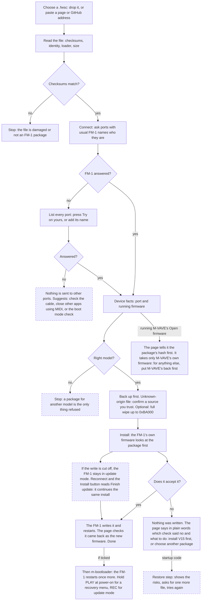

# fm-static

**[Open fm-static](https://seajaysec.github.io/fm-static/)**

A web page that installs a `.fwsc` firmware file on an M-VAVE FM-1 over USB, for one situation:
**your FM-1's MIDI port has a different name on your computer, and the usual updaters can't find it.**

That can happen on purpose (you renamed the device) or by itself. On a Mac, Audio MIDI Setup names a
USB MIDI port from its own cache, keyed by the USB id and the socket. Many FM-1 firmwares share the
same USB id and send no serial number, so an FM-1 can show the name of another device or firmware
that was last plugged into that socket. Updaters that look for the FM-1 by name then report it as
not found, or lose it halfway through an update.

If your firmware's own updater, or M-VAVE's, works for you, use that instead.

## What it does

- Reads any `.fwsc` in the browser (nothing is uploaded), checks its CRCs and shows its identity and
  SHA-256. Only the unmodified official V15 is recognised by hash; anything else is labelled, and a
  file of unknown origin needs a confirmation before it can be installed.
- Can find the file for you: paste the address of a page, or of a GitHub repository, that offers firmware, and the browser reads it itself,
  lists the `.fwsc` files in its source (or loads the one it finds). It works only for sites that allow other pages to
  read them; for the rest it says so and you download the file and drop it in.
- Optional **full wipe**: writes the chosen firmware with M-VAVE's update loader over a package covering flash up to 0xBA000,
  so every sector in that range is erased first (saved projects and settings kept there are lost). The package is built
  from the official V15 package's loader and startup code plus the chosen firmware's app area, the way a Baudgirl
  release is V15 with another flash.bin; the builder reproduces all ten Baudgirl packages inspected byte for byte.
- Can read a GitHub repository address: it lists the `.fwsc` files committed in the repo (loadable) and attached to
  releases (download-only: GitHub does not let a web page read those). For files GitHub holds a build attestation for, it
  shows which workflow built them from which commit; it reports what GitHub says and does not verify the signature.
- Lists every MIDI port. Ports with a usual FM-1 name are asked who they are; any other port is sent
  nothing until you press **Try this port** on it.
- Lets you keep your own port names, so the page finds your FM-1 by itself next time (stored in
  your browser only).
- During an install, follows the FM-1 as its port changes when it restarts into the update loader
  and back.
- If an update was cut off and the FM-1 is still in update mode, offers **Finish update**.
- Installs over any firmware: it never refuses because of what the FM-1 runs now (only a wrong model). It reads the
  package (which update loader it carries, flash.bin size, whether its startup code is official V15's) and lists what it
  saw as checkpoints, including what an installer that only starts from V15 would have stopped on.
- If a Felucca-family firmware refuses a package, it says which check refused (app area size, loader, or startup code).
  For the startup-code refusal there is an opt-in **Restore official startup code** mode: it answers that check with the
  startup code of a Felucca-family file you pick, then M-VAVE's loader writes the package. It rewrites the region a
  failed write can leave unbootable, and has not been run on a device; the page lists the risks and why.

Needs Chrome or Edge on a computer (Web MIDI with SysEx). Installing firmware is at your own risk.

To fix the name itself on a Mac: Audio MIDI Setup, Window, Show MIDI Studio, double-click the device.

## Where the update protocol comes from

The update protocol and the package reader are [fm1-base](https://github.com/charlesvestal/fm1-base)'s, copied unmodified into
`vendor/fm1-base/` (recorded in `vendor/fm1-base/SOURCE`). `src/updater.js` adds what the page does on top: finding the FM-1 under any
port name, following the ports through the update loader, the restore step, and what step 1 refused. To take fm1-base's latest:
`tools/sync-base.sh`. A weekly GitHub job does the same and opens a pull request when anything changed, so fixes arrive for review
and nothing reaches the page without a merge. `node tools/check-vendor.mjs` checks the copies still offer what the adapter uses.

## How it gets past a snag

Where the page checks something, what it does when the check fails, and what you are offered. Boxes with a dashed outline
are paths that have not been run on an FM-1 yet.



## What has and has not been tested

Run on a real FM-1 (macOS, Chrome): installs in every direction between official V15, M-VAVE's V16, Baudgirl releases,
Felucca-family firmwares and Mutable Dreams, with and without the full wipe; a real refusal by a newer Felucca and the way
round it; installing m-bootloader after a firmware and then putting M-VAVE's V16 back over it; a package found through a
GitHub address; an FM-1 whose port name the page does not recognise (found with Try this port, then followed through the
update loader); another app holding the MIDI ports during an install; M-VAVE's Open firmware (V14, installed with M-VAVE's own Workbench) and from it back to M-VAVE's V16 through this page.

Not tested on a device: finishing an interrupted update, the startup-code refusal and the restore step, boot-mode
detection, the wrong-model refusal, m-bootloader's recovery menu and update-mode keys. Out of scope:
how the firmware sounds, the SMK-37 (it may work; completely untested), browsers other than Chrome.

## Lineage and licence

The update protocol and package reading come from [Felucca](https://github.com/hugelton/Felucca)'s
web installer by Leo Kuroshita (Hügelton Instruments), modified here to discover ports. fm-static is
GPL-3.0-only like Felucca; see [LICENSE](LICENSE) and [NOTICE](NOTICE).

## Running it locally

It is plain static files with no build step. Web MIDI needs `https://` or `localhost`:

```
python3 -m http.server 8000     # then open http://localhost:8000/
```
